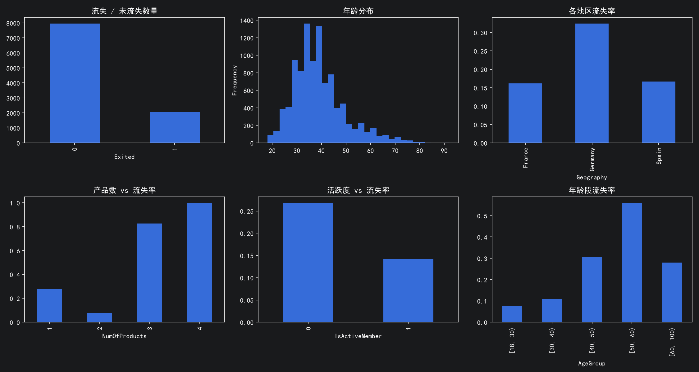

在不平衡： 若模型把所有人预测为"不流失"，准确率仍有 79.63%， 因此 Accuracy 不能作为主评价指标，应以 Recall 和 PR-AUC 为主。

2. 年龄
流失率随年龄上升，50-59 组最高，为 56.04%；但 60+ 组回落到 27.95%。 该组仅 526 人，样本量小，这个回落不宜直接解释为业务规律。

3. 地区
Germany 32.44%、Spain 16.67%、France 16.15%。Germany 只有 2509 人， France 有 5014 人；若改用流失人数（814 对 810）会误判两地风险相同， 所以必须比较流失率而不是流失人数。

4. 产品数
1/2/3/4 个产品的流失率分别为 27.71 / 7.58 / 82.71 / 100 %。 其中 3 产品组仅 266 人、4 产品组仅 60 人且全部流失， 小样本加标签高度同质，很可能是数据采集口径造成的，不宜当作可靠规律。

5. 活跃度
非活跃 26.85%、活跃 14.27%，相差约 12.6 个百分点， 是本次 EDA 中最强的单特征信号